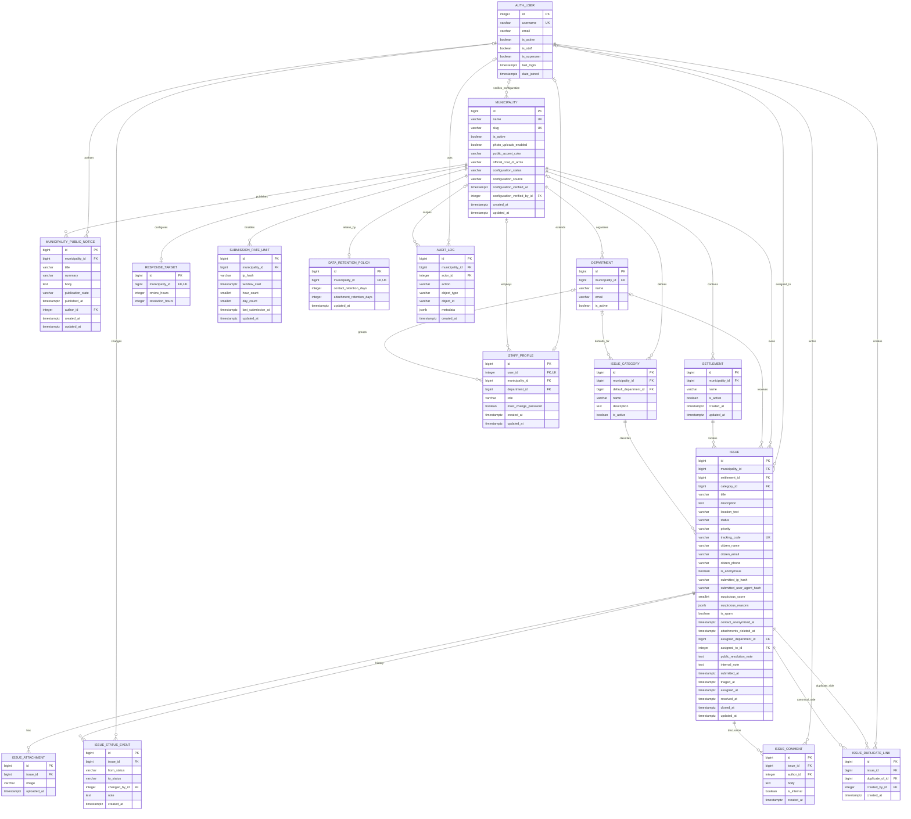

# Database Schema Design

This document is the detailed database design for **Opštinski Inbox / Sredi**. It is based on the Django models and migrations currently in the repository and targets PostgreSQL 16.

## 1. Design goals

- Keep every citizen report inside one municipality data boundary.
- Support anonymous reports without requiring a citizen account.
- Preserve a complete staff workflow history and audit trail.
- Keep public and internal communication separate.
- Support municipality-wide defaults with category-specific overrides.
- Store uploaded files outside PostgreSQL while retaining file metadata and ownership in PostgreSQL.
- Make privacy retention enforceable per municipality.
- Keep report writes transactional while using Redis for shared caches/throttles and Celery for email, retention, cleanup, and monitoring.

`Municipality.photo_uploads_enabled` defaults to `False` for the text-only pilot. It controls new citizen uploads; existing attachment rows, private files, and municipal crests remain intact.

## 2. Conventions

| Convention | Design |
|---|---|
| Database | PostgreSQL 16 |
| Primary keys | `bigint` identity through Django `BigAutoField`, except Django's built-in `auth_user.id` |
| Timestamps | timezone-aware `timestamp with time zone` |
| JSON | PostgreSQL `jsonb` through Django `JSONField` |
| File fields | relative storage keys in `varchar`; binary files live in private media/object storage |
| Tenant boundary | `municipality_id` |
| Citizen identity | optional contact fields on `issues_issue`; there is no citizen-account table |
| Staff identity | Django `auth_user` plus one optional `accounts_staffprofile` |
| Delete policy | master/configuration rows cascade where safe; issue ownership/classification rows are protected |

`PK` = primary key, `FK` = foreign key, `UQ` = unique, `NN` = not null.

## 3. Entity relationship diagram

## 4. Table specifications

### 4.1 `municipalities_municipality`

Top-level municipality configuration and the primary data-ownership boundary.

| Column | Type | Null/default | Rules and purpose |
|---|---|---|---|
| `id` | bigint | NN | PK |
| `name` | varchar(160) | NN | UQ; official display name |
| `slug` | varchar(180) | NN | UQ; public URL key such as `konce` |
| `is_active` | boolean | `true` | Controls visibility and public API access |
| `public_accent_color` | varchar(7) | empty string | Optional `#RRGGBB` branding value |
| `official_coat_of_arms` | varchar(100) | empty string | Storage key for an approved crest image |
| `configuration_status` | varchar(20) | `unverified` | `unverified` or `verified` |
| `configuration_source` | varchar(255) | empty string | Provenance of imported municipality data |
| `configuration_verified_at` | timestamptz | nullable | Verification time |
| `configuration_verified_by_id` | integer | nullable | FK → `auth_user.id`, `ON DELETE SET NULL` |
| `created_at` | timestamptz | generated | Creation time |
| `updated_at` | timestamptz | generated | Last model save time |

Delete behavior: dependent settlements, departments, notices, response targets, retention policies, and rate-limit rows cascade. Issues protect the municipality from deletion while reports exist.

### 4.2 `municipalities_municipalitypublicnotice`

Draft and published public notices for one municipality.

| Column | Type | Null/default | Rules and purpose |
|---|---|---|---|
| `id` | bigint | NN | PK |
| `municipality_id` | bigint | NN | FK → municipality, `ON DELETE CASCADE` |
| `title` | varchar(180) | NN | Notice heading |
| `summary` | varchar(320) | NN | Public card summary |
| `body` | text | NN | Full notice |
| `publication_state` | varchar(16) | `draft` | `draft` or `published` |
| `published_at` | timestamptz | nullable | Required by model validation when published |
| `author_id` | integer | nullable | FK → `auth_user.id`, `ON DELETE SET NULL` |
| `created_at` | timestamptz | generated | Creation time |
| `updated_at` | timestamptz | generated | Update time |

### 4.3 `municipalities_settlement`

Municipality-scoped list of towns, villages, and settlements used by the report form.

| Column | Type | Null/default | Rules and purpose |
|---|---|---|---|
| `id` | bigint | NN | PK |
| `municipality_id` | bigint | NN | FK → municipality, `ON DELETE CASCADE` |
| `name` | varchar(160) | NN | UQ together with `municipality_id` |
| `is_active` | boolean | `true` | Inactive values remain available to historical reports |
| `created_at` | timestamptz | generated | Creation time |
| `updated_at` | timestamptz | generated | Update time |

### 4.4 `municipalities_department`

Municipal organizational units used for routing, staffing, and assignment.

| Column | Type | Null/default | Rules and purpose |
|---|---|---|---|
| `id` | bigint | NN | PK |
| `municipality_id` | bigint | NN | FK → municipality, `ON DELETE CASCADE` |
| `name` | varchar(160) | NN | UQ together with `municipality_id` |
| `email` | varchar(254) | empty string | Optional operational mailbox |
| `is_active` | boolean | `true` | Controls new assignments |

### 4.5 `auth_user`

Django's built-in authentication identity. Password hashes, login state, group, and permission relationships remain managed by Django.

Product-relevant columns are `id`, `username`, `email`, `password`, `is_active`, `is_staff`, `is_superuser`, `last_login`, and `date_joined`. Citizen reports never require an `auth_user` row.

### 4.6 `accounts_staffprofile`

One-to-one extension that gives a user municipal scope and workflow role.

| Column | Type | Null/default | Rules and purpose |
|---|---|---|---|
| `id` | bigint | NN | PK |
| `user_id` | integer | NN | UQ FK → `auth_user.id`, `ON DELETE CASCADE` |
| `municipality_id` | bigint | nullable | FK → municipality, `ON DELETE PROTECT`; null is reserved for platform-level accounts |
| `department_id` | bigint | nullable | FK → department, `ON DELETE PROTECT` |
| `role` | varchar(40) | `viewer` | Role enum shown below |
| `must_change_password` | boolean | `false` | Blocks workspace access until a temporary password is replaced |
| `created_at` | timestamptz | generated | Creation time |
| `updated_at` | timestamptz | generated | Update time |

Roles: `municipality_admin`, `coordinator`, `department_manager`, `field_worker`, and `viewer`.

2FA state uses `otp_totp_totpdevice` for the TOTP secret, `accounts_recoverycode` for keyed-hash single-use recovery codes, `accounts_trusteddevice` for keyed-hash 30-day browser tokens, and `accounts_authenticationattempt` for the 15-minute password/OTP failure window. Raw recovery and trusted-device tokens are never stored.

### 4.7 `issues_issuecategory`

Issue taxonomy. A null `municipality_id` represents a shared/global category; otherwise the category belongs to one municipality.

| Column | Type | Null/default | Rules and purpose |
|---|---|---|---|
| `id` | bigint | NN | PK |
| `municipality_id` | bigint | nullable | FK → municipality, `ON DELETE CASCADE` |
| `name` | varchar(160) | NN | UQ with `municipality_id` under the current model |
| `description` | text | empty string | Citizen/staff guidance |
| `default_department_id` | bigint | nullable | FK → department, `ON DELETE SET NULL` |
| `is_active` | boolean | `true` | Controls form availability |

### 4.8 `issues_issue`

The private `title` remains operational data. `public_title`, `public_title_approved_at`, and `public_title_approved_by_id` form a separate moderation record; a report is absent from public latest-report lists until these approval fields are present.

Central case/report record. It contains the citizen submission, current workflow projection, optional contact information, assignment, workflow timestamps, and privacy-retention markers.

| Column | Type | Null/default | Rules and purpose |
|---|---|---|---|
| `id` | bigint | NN | PK |
| `municipality_id` | bigint | NN | FK → municipality, `ON DELETE PROTECT` |
| `settlement_id` | bigint | NN | FK → settlement, `ON DELETE PROTECT` |
| `category_id` | bigint | NN | FK → category, `ON DELETE PROTECT` |
| `title` | varchar(180) | NN | Short report title |
| `description` | text | NN | Full citizen description |
| `location_text` | varchar(255) | NN | Address, landmark, or directions; no coordinates in MVP |
| `status` | varchar(40) | `pending_triage` | Current state projection |
| `priority` | varchar(20) | `normal` | `low`, `normal`, `high`, or `urgent` |
| `tracking_code` | varchar(16) | generated | Globally UQ; public lookup secret |
| `citizen_name` | varchar(160) | empty string | Optional PII |
| `citizen_email` | varchar(254) | empty string | Optional PII and receipt destination |
| `citizen_phone` | varchar(40) | empty string | Optional PII |
| `is_anonymous` | boolean | `true` | Derived on save from the three contact fields |
| `submitted_ip_hash` | varchar(128) | empty string | SHA-256 hash; never raw IP |
| `submitted_user_agent_hash` | varchar(128) | empty string | SHA-256 hash; never raw user-agent |
| `suspicious_score` | positive smallint | `0` | Heuristic score capped at 100 by service logic |
| `suspicious_reasons` | jsonb | `[]` | Array of `{code, label, points}` objects |
| `is_spam` | boolean | `false` | Excludes the issue from public aggregate statistics |
| `contact_anonymized_at` | timestamptz | nullable | Contact/hash retention completed marker |
| `attachments_deleted_at` | timestamptz | nullable | Attachment retention completed marker |
| `assigned_department_id` | bigint | nullable | FK → department, `ON DELETE SET NULL` |
| `assigned_to_id` | integer | nullable | FK → `auth_user.id`, `ON DELETE SET NULL` |
| `public_resolution_note` | text | empty string | Public-facing resolution/update text |
| `internal_note` | text | empty string | Staff-only case note |
| `submitted_at` | timestamptz | generated | Submission and response-target origin time |
| `triaged_at` | timestamptz | nullable | First accepted/rejected/out-of-jurisdiction time |
| `assigned_at` | timestamptz | nullable | First assigned state or assignment time |
| `resolved_at` | timestamptz | nullable | First resolved time |
| `closed_at` | timestamptz | nullable | First closed time |
| `attachment_retention_started_at` | timestamptz | nullable | First entry into a final status; cleared on reopening |
| `version` | positive integer | `1` | Optimistic-concurrency version for staff mutations |
| `updated_at` | timestamptz | generated | Last model save time |

Statuses: `pending_triage`, `accepted`, `assigned`, `in_progress`, `resolved`, `closed`, `duplicate`, `rejected_spam`, `not_jurisdiction`, `waiting_citizen`, `waiting_external`, and `procurement_needed`.

### 4.9 `issues_issueattachment`

Private photo metadata. The `image` value is a randomized storage key such as `issues/<tracking-code>/<random-token>.webp`; bytes are not stored in PostgreSQL.

| Column | Type | Null/default | Rules and purpose |
|---|---|---|---|
| `id` | bigint | NN | PK |
| `issue_id` | bigint | NN | FK → issue, `ON DELETE CASCADE` |
| `image` | varchar(100) | NN | Private storage key |
| `original_size_bytes` | positive bigint | nullable | Input byte size before normalization; null on unmigrated legacy rows |
| `stored_size_bytes` | positive bigint | nullable | Stored WebP byte size |
| `processed_width` | positive integer | nullable | Stored pixel width |
| `processed_height` | positive integer | nullable | Stored pixel height |
| `stored_format` | varchar(16) | nullable | Normalized format (`WEBP`) |
| `processing_version` | positive smallint | nullable, indexed | Idempotency marker for the processing profile |
| `deletion_state` | varchar(24) | `active` | Active, deletion-pending, deleted, or deletion-failed tombstone state |
| `deletion_started_at` | timestamptz | nullable | Start of the two-phase delete |
| `deleted_at` | timestamptz | nullable | Successful storage deletion time |
| `deletion_reason` | varchar(160) | empty string | Stable retention/deletion reason |
| `deletion_error` | text | empty string | Retry-safe storage error class; never a filename |
| `uploaded_at` | timestamptz | generated | Upload time |

The application accepts at most 5 JPG/PNG/WEBP images per submission, each at most 5 MB and 24 megapixels by default. Pillow applies EXIF orientation, strips metadata, limits the longest edge to 2048 px without upscaling, and stores only a WebP of at most 800 KiB. Corrupt, spoofed, animated, and oversized images are rejected. These are service rules, not database constraints.

### 4.10 `issues_issuestatusevent`

Append-oriented status history. `issues_issue.status` is the current projection; this table explains how it changed.

| Column | Type | Null/default | Rules and purpose |
|---|---|---|---|
| `id` | bigint | NN | PK |
| `issue_id` | bigint | NN | FK → issue, `ON DELETE CASCADE` |
| `from_status` | varchar(40) | empty string allowed | Previous status |
| `to_status` | varchar(40) | NN | New status |
| `changed_by_id` | integer | nullable | FK → `auth_user.id`, `ON DELETE SET NULL` |
| `note` | text | empty string | Required by service logic for sensitive outcomes |
| `created_at` | timestamptz | generated | Event time |

### 4.11 `issues_issuecomment`

Staff-authored communication. `is_internal=true` is private; `false` appears on citizen tracking.

| Column | Type | Null/default | Rules and purpose |
|---|---|---|---|
| `id` | bigint | NN | PK |
| `issue_id` | bigint | NN | FK → issue, `ON DELETE CASCADE` |
| `author_id` | integer | NN | FK → `auth_user.id`, `ON DELETE PROTECT` |
| `body` | text | NN | Comment body |
| `is_internal` | boolean | `true` | Visibility boundary |
| `created_at` | timestamptz | generated | Comment time |

### 4.12 `issues_issueduplicatelink`

Self-referencing relation between a duplicate report and the canonical report.

| Column | Type | Null/default | Rules and purpose |
|---|---|---|---|
| `id` | bigint | NN | PK |
| `issue_id` | bigint | NN | FK → duplicate issue, `ON DELETE CASCADE` |
| `duplicate_of_id` | bigint | NN | FK → canonical issue, `ON DELETE CASCADE` |
| `created_by_id` | integer | NN | FK → `auth_user.id`, `ON DELETE PROTECT` |
| `created_at` | timestamptz | generated | Link time |

### 4.13 `issues_responsetarget`

Simple internal response targets for one municipality. Targets help staff prioritize work; they are not contractual delivery guarantees.

| Column | Type | Null/default | Rules and purpose |
|---|---|---|---|
| `id` | bigint | NN | PK |
| `municipality_id` | bigint | NN | UQ FK → municipality, `ON DELETE CASCADE` |
| `review_hours` | positive integer | `24` | Target for reviewing a pending report |
| `resolution_hours` | positive integer | `240` | Non-triage resolution deadline |

Each municipality has at most one row. Runtime fallback values are 24 review hours and 240 resolution hours.

### 4.14 `issues_submissionratelimit`

Legacy rollback-only per-municipality/per-network submission counters. New requests use atomic Redis counters with TTLs; these rows are no longer created and are pruned after 48 hours.

| Column | Type | Null/default | Rules and purpose |
|---|---|---|---|
| `id` | bigint | NN | PK |
| `municipality_id` | bigint | NN | FK → municipality, `ON DELETE CASCADE` |
| `ip_hash` | varchar(128) | NN | Hashed client IP |
| `window_start` | timestamptz | NN | Daily window origin |
| `hour_count` | positive smallint | `0` | Current hourly count |
| `day_count` | positive smallint | `0` | Current daily count |
| `last_submission_at` | timestamptz | nullable | Hour-window calculation anchor |
| `updated_at` | timestamptz | generated | Cleanup anchor |

UQ: (`municipality_id`, `ip_hash`). Default limits are 3/hour and 10/day. Rows older than 48 hours are deleted during retention processing.

### 4.15 `issues_dataretentionpolicy`

One policy per municipality.

| Column | Type | Null/default | Rules and purpose |
|---|---|---|---|
| `id` | bigint | NN | PK |
| `municipality_id` | bigint | NN | UQ FK → municipality, `ON DELETE CASCADE` |
| `contact_retention_days` | positive integer | `365` | Days after closure before contact/hash anonymization |
| `attachment_retention_days` | positive integer | `90` | Days after final-status entry, or submission while unresolved, before attachment bytes are removed |
| `updated_at` | timestamptz | generated | Policy update time |

### 4.16 `issues_auditlog`

Append-oriented security and business audit record.

| Column | Type | Null/default | Rules and purpose |
|---|---|---|---|
| `id` | bigint | NN | PK |
| `municipality_id` | bigint | nullable | FK → municipality, `ON DELETE SET NULL` |
| `actor_id` | integer | nullable | FK → `auth_user.id`, `ON DELETE SET NULL` |
| `action` | varchar(120) | NN | Stable action key |
| `object_type` | varchar(120) | NN | Generic target type, usually `Issue` |
| `object_id` | varchar(120) | empty string | Generic target identifier |
| `metadata` | jsonb | `{}` | Before/after values and action context |
| `created_at` | timestamptz | generated | Audit time |

The generic target intentionally has no FK because audit rows must survive user/target deletion and can describe different object types.

## 5. Ownership and integrity rules

The application currently enforces the following cross-table rules in forms/services:

1. A public form only offers settlements belonging to the selected municipality.
2. A category must be global or belong to the selected municipality.
3. Assignment department and assignee choices are limited to the issue municipality.
4. Non-superusers can only query issues matching `staff_profile.municipality_id`.
5. Department managers can act only on issues assigned to their department.
6. Field workers can act only on issues assigned directly to them and can move them only to `in_progress` or `resolved`.
7. A public resolution note is copied to a non-internal comment so it appears in tracking history.
8. Status changes create both an `IssueStatusEvent` and an `AuditLog`.

The following database constraints are recommended before production. They are design requirements but are **not all present in the current migrations**:

- `Issue.settlement.municipality_id = Issue.municipality_id`.
- `Issue.category.municipality_id IS NULL OR = Issue.municipality_id`.
- `Issue.assigned_department.municipality_id = Issue.municipality_id` when assigned.
- `Issue.assigned_to.staff_profile.municipality_id = Issue.municipality_id` when assigned.
- `StaffProfile.department.municipality_id = StaffProfile.municipality_id` when a department is set.
- `IssueCategory.default_department.municipality_id = IssueCategory.municipality_id`; global categories need an explicit rule for defaults.
- One response-target row per municipality configuration.
- `IssueDuplicateLink.issue_id <> duplicate_of_id`, both issues must share a municipality, and the pair must be unique.
- A published notice must have `published_at IS NOT NULL`.
- `suspicious_score BETWEEN 0 AND 100` and rate-limit counters must be nonnegative.
- Sensitive status transitions (`resolved`, `duplicate`, `rejected_spam`, `not_jurisdiction`) must have a nonblank event note.

Cross-row/cross-table tenant checks cannot be expressed as ordinary PostgreSQL `CHECK` constraints. Use deferrable constraint triggers or retain service validation plus targeted integrity tests.

## 6. Index plan

### Existing explicit indexes

| Table | Index | Use |
|---|---|---|
| `issues_issue` | (`municipality_id`, `status`) | Municipality inbox/status counts |
| `issues_issue` | (`settlement_id`, `status`) | Settlement/status filters |
| `issues_issue` | (`tracking_code`) | Tracking lookup; the unique constraint already creates a unique index, so this explicit index is redundant |
| `issues_submissionratelimit` | (`municipality_id`, `ip_hash`) | Rate-limit lookup; also covered by its unique constraint |
| `issues_submissionratelimit` | (`window_start`) | Window/cleanup queries |

Django also creates indexes for foreign-key columns and unique constraints.

### Recommended production indexes

| Table | Recommended index | Query served |
|---|---|---|
| `issues_issue` | (`municipality_id`, `submitted_at DESC`) | Default staff inbox and public time series |
| `issues_issue` | (`municipality_id`, `status`, `submitted_at DESC`) | Status-filtered inbox pages |
| `issues_issue` | (`assigned_to_id`, `status`, `submitted_at DESC`) WHERE `assigned_to_id IS NOT NULL` | “My issues” |
| `issues_issue` | (`assigned_department_id`, `status`, `submitted_at DESC`) WHERE `assigned_department_id IS NOT NULL` | Department queues |
| `issues_issue` | (`municipality_id`, `category_id`, `submitted_at`) | Category statistics and response-time reporting |
| `issues_issue` | (`municipality_id`, `is_spam`, `submitted_at`) | Public statistics |
| `issues_issuestatusevent` | (`issue_id`, `created_at`) | Citizen/staff timeline |
| `issues_issuecomment` | (`issue_id`, `is_internal`, `created_at`) | Public versus internal timeline |
| `issues_auditlog` | (`object_type`, `object_id`, `created_at DESC`) | Case audit history |
| `issues_auditlog` | (`municipality_id`, `created_at DESC`) | Municipal audit review |
| `issues_submissionratelimit` | (`updated_at`) | 48-hour cleanup (matches the actual retention query better than `window_start`) |
| `municipalities_municipalitypublicnotice` | (`municipality_id`, `publication_state`, `published_at DESC`) | Published notices |

For staff free-text search at larger volume, add PostgreSQL trigram GIN indexes on `title`, `location_text`, and optionally `tracking_code`; ordinary B-tree indexes do not accelerate `%term%` searches.

## 7. Transaction and consistency boundaries

- Rate-limit consumption uses atomic Redis fixed-window increments with expiring keys.
- Rate-limit consumption commits before issue creation, so a later issue-write failure still consumes an attempt.
- Images are fully processed before issue creation. Issue and attachment rows are written in one database transaction; any files written before a database/storage failure are tracked and deleted on rollback.
- Bulk assignment locks selected issues and updates at most 100 reports in one transaction.
- Version-checked staff mutations lock the issue and commit the projection, history event, and audit row atomically.
- Retention marks each attachment deletion-pending under a row lock, deletes storage after commit, and preserves a deleted or retryable-failed tombstone.

## 8. Privacy and visibility boundaries

| Data | Stored in | Public exposure |
|---|---|---|
| Name/email/phone | `issues_issue` | Never included in public tracking/statistics serializers |
| IP and user-agent | SHA-256 hashes on `issues_issue` | Never public |
| Photos | Private file storage + `issues_issueattachment` | Authenticated municipality-scoped staff endpoint only |
| Internal notes | `issues_issue.internal_note` | Staff only |
| Internal comments | `issues_issuecomment.is_internal=true` | Staff only |
| Public updates | Public comments, status events, public resolution note | Available only with municipality slug + tracking code |
| Statistics | Computed from issues | Aggregate groups under 5 are suppressed; spam rows are excluded |
| Audit data | `issues_auditlog` | Staff detail/admin only |

## 9. Retention lifecycle

1. Retention eligibility begins only after `Issue.closed_at` is set.
2. After `contact_retention_days`, name, email, phone, IP hash, and user-agent hash are cleared and `contact_anonymized_at` is set.
3. After `attachment_retention_days`, file objects and attachment rows are deleted and `attachments_deleted_at` is set.
4. Rate-limit rows inactive for 48 hours are deleted.
5. Every applied action and the overall municipality retention run produce audit entries.
6. The issue, workflow history, non-PII case content, and audit history remain for operational/statistical continuity.

## 10. Scope boundary

The diagram deliberately shows only the product tables plus `auth_user`. Django also creates framework tables such as sessions, migrations, groups, permissions, content types, admin logs, and optional OTP tables. Those tables support the framework but are not part of the municipal case-management domain.
