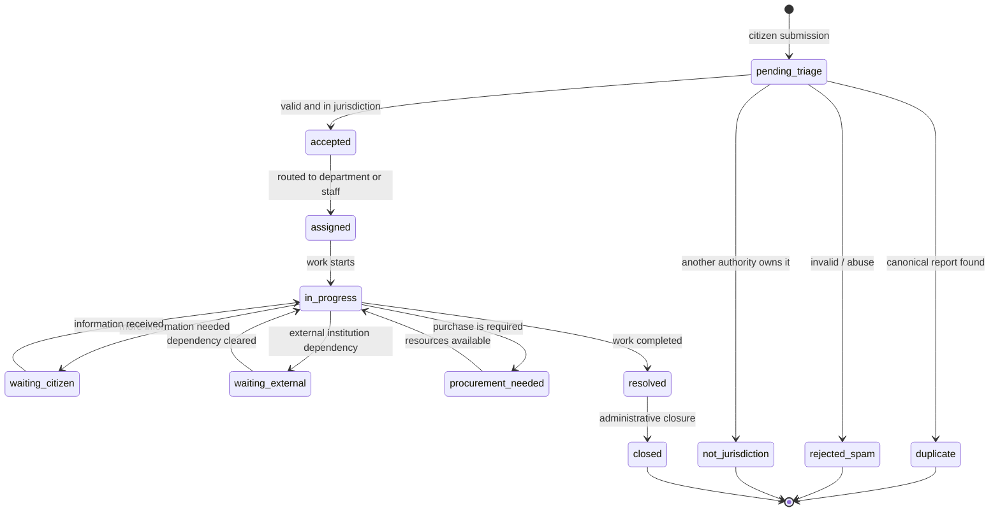

# Detailed System Flow

This document describes the end-to-end runtime flow for **Sredi** (citizen side) and **Opštinski Inbox** (staff side). The master chart is followed by the status lifecycle, role authorization, and failure/side-effect details needed to interpret it.

## 1. Master flow chart

```mermaid
flowchart TB
    Start([Citizen opens Sredi]) --> ListMunicipalities[GET /api/municipalities<br/>Load active municipalities]
    ListMunicipalities --> SelectMunicipality{Citizen selects<br/>municipality}
    SelectMunicipality -->|No active municipality| Public404[Show unavailable / not found]
    SelectMunicipality -->|Active slug| MunicipalLanding[Open /municipality-slug]

    subgraph Citizen_Submission[Citizen report submission]
        MunicipalLanding --> OpenForm[Open /municipality-slug/prijavi]
        OpenForm --> FormOptions[GET form-options<br/>Active settlements + local/global categories]
        FormOptions --> EnterReport[Enter settlement, category, title,<br/>description, location and optional contact data]
        EnterReport --> PhotosEnabled{Municipality photo uploads enabled?<br/>Default: no}
        PhotosEnabled -->|No: pilot| Consent[Accept processing consent<br/>Optional email receipt]
        PhotosEnabled -->|Yes: later opt-in| AttachPhotos[Optionally attach up to 5 photos<br/>JPG / PNG / WEBP]
        AttachPhotos --> Consent
        Consent --> Submit[POST JSON for text-only pilot<br/>multipart for enabled uploads]
        Submit --> MunicipalityCheck{Municipality slug exists<br/>and is active?}
        MunicipalityCheck -->|No| Public404
        MunicipalityCheck -->|Yes| FormValidation{Form valid?<br/>Consent, honeypot, scoped options,<br/>receipt requires email,<br/>reject files when uploads disabled}
        FormValidation -->|No| ValidationError[400 field errors]
        ValidationError --> EnterReport
        FormValidation -->|Yes| HashClient[Resolve trusted client IP<br/>Store SHA-256 IP and user-agent hashes]
        HashClient --> LockRateRow[Atomic Redis counters with TTL<br/>by municipality + IP hash]
        LockRateRow --> RateAllowed{Below configured<br/>hour and day limits?}
        RateAllowed -->|No| RateLimited[429 + Retry-After<br/>No issue created]
        RateAllowed -->|Yes| PhotoValidation{Uploads valid?<br/>count, extension, MIME,<br/>size and Pillow decode}
        PhotoValidation -->|No| UploadError[400 photo errors<br/>reserved slot remains consumed]
        UploadError --> AttachPhotos
        PhotoValidation -->|Yes| AssessRisk[Calculate suspicious score<br/>frequency + daily volume + repeated text/location + photo count]
        AssessRisk --> SaveIssue[Atomic DB write:<br/>Issue in pending_triage + unique tracking code]
        SaveIssue --> SaveAttachments[Only when photos supplied:<br/>store normalized WebP attachments]
        SaveAttachments --> ReceiptRequested{Email receipt requested?}
        ReceiptRequested -->|No| ReceiptSkipped[receipt_delivery = not_requested]
        ReceiptRequested -->|Yes| SendReceipt[Create delivery record after commit<br/>queue Celery email task]
        SendReceipt --> ReceiptQueued[receipt_delivery = queued]
        ReceiptSkipped --> SubmissionSuccess
        ReceiptQueued --> SubmissionSuccess
        SubmissionSuccess[201: show tracking code<br/>and initial status]
    end

    SubmissionSuccess --> CitizenChoice{Citizen next action}

    subgraph Citizen_Tracking[Citizen tracking]
        CitizenChoice -->|Track report| EnterCode[Open tracking page<br/>Enter private tracking code]
        EnterCode --> TrackRequest[GET track?code=...<br/>Normalize case, spaces and hyphens]
        TrackRequest --> ScopedLookup[Lookup by municipality + code<br/>then constant-time compare]
        ScopedLookup --> TrackFound{Matching report?}
        TrackFound -->|No| Track404[404 generic not-found response]
        Track404 --> EnterCode
        TrackFound -->|Yes| BuildTimeline[Build chronological timeline:<br/>submission + latest public updates<br/>capped at 100]
        BuildTimeline --> TrackingView[Return safe fields only:<br/>title, category, settlement, status and public updates]
    end

    subgraph Public_Statistics[Public aggregate dashboard]
        CitizenChoice -->|View statistics| StatsRequest[GET statistics<br/>period + settlement + category + public status filters]
        StatsRequest --> StatsScope[Filter selected municipality<br/>and exclude is_spam = true]
        StatsScope --> Aggregate[Compute total/open/resolved/pending,<br/>time series, distributions and medians]
        Aggregate --> TargetMetric[Compare resolutions with the municipality target,<br/>or use the 240h fallback]
        TargetMetric --> SuppressSmallGroups[Suppress category, settlement and<br/>time groups containing fewer than 5 reports]
        SuppressSmallGroups --> StatsOutput[Return dashboard JSON<br/>or UTF-8 CSV]
    end

    subgraph Staff_Authentication[Staff authentication and scope]
        StaffStart([Staff opens /staff]) --> SessionCheck[GET auth/session + CSRF token]
        SessionCheck --> Authenticated{Authenticated session?}
        Authenticated -->|No| Login[POST username/password + CSRF]
        Login --> CredentialsValid{Django authentication succeeds?}
        CredentialsValid -->|No| LoginError[400 invalid credentials]
        LoginError --> Login
        CredentialsValid -->|Yes| CreateSession[Create session cookie]
        Authenticated -->|Yes| LoadStaffScope
        CreateSession --> LoadStaffScope{Superuser?}
        LoadStaffScope -->|Yes| PlatformScope[All municipalities]
        LoadStaffScope -->|No, profile has municipality| MunicipalityScope[Only profile municipality]
        LoadStaffScope -->|No valid scope| EmptyScope[No issue rows / actions]
    end

    subgraph Staff_Inbox[Staff inbox and case access]
        PlatformScope --> InboxQuery
        MunicipalityScope --> InboxQuery[Build authorized issue queryset]
        EmptyScope --> StaffNoAccess[Empty dashboard]
        InboxQuery --> Filters[Apply search, municipality, status,<br/>settlement, category, priority, department,<br/>assignee, mine, unassigned, overdue and due-soon]
        Filters --> TargetEvaluation[Compute the active municipality target:<br/>review target while pending → resolution target afterward]
        TargetEvaluation --> InboxPage[Sort, paginate, metrics and permitted quick actions]
        InboxPage --> OpenCase[GET authorized issue detail]
        OpenCase --> DetailData[Load attachments, comments,<br/>status events and last 20 audit logs]
        DetailData --> CaseAction{Chosen case action}
    end

    subgraph Authorization[Per-action authorization]
        CaseAction --> PermissionCheck{Role and ownership check}
        PermissionCheck -->|Viewer| DenyAction[403 read-only]
        PermissionCheck -->|Field worker| FieldRule{Assigned directly<br/>to this user?}
        FieldRule -->|No| DenyAction
        FieldRule -->|Yes| FieldActions[Comment or status only:<br/>in_progress / resolved]
        PermissionCheck -->|Department manager| DepartmentRule{Issue assigned to<br/>manager's department?}
        DepartmentRule -->|No| DenyAction
        DepartmentRule -->|Yes| DepartmentActions[Comment and status change]
        PermissionCheck -->|Coordinator / municipality admin| TriageActions[Update, assign, comment,<br/>and change any valid status in municipality]
        PermissionCheck -->|Superuser| PlatformActions[Full cross-municipality action]
    end

    subgraph Case_Mutations[Case mutations]
        FieldActions --> MutationChoice{Mutation type}
        DepartmentActions --> MutationChoice
        TriageActions --> MutationChoice
        PlatformActions --> MutationChoice

        MutationChoice -->|Update fields| ValidateAssignment[Validate priority, department and assignee<br/>against issue municipality]
        ValidateAssignment --> UpdateIssue[Save assignment, internal note<br/>and/or public resolution note]
        UpdateIssue --> AuditUpdate[Audit changed before/after fields]
        AuditUpdate --> PublicNoteChanged{New nonblank public<br/>resolution note?}
        PublicNoteChanged -->|Yes| PublishPublicComment[Create non-internal comment<br/>for citizen timeline]
        PublicNoteChanged -->|No| RefreshCase
        PublishPublicComment --> AuditPublicNote[Audit public update]
        AuditPublicNote --> RefreshCase

        MutationChoice -->|Change status| ValidateStatus[Validate enum + role permission]
        ValidateStatus --> SensitiveOutcome{Resolved, duplicate, spam/rejected,<br/>or not in jurisdiction?}
        SensitiveOutcome -->|Yes, note blank| NoteRequired[400: staff note required]
        NoteRequired --> CaseAction
        SensitiveOutcome -->|No or note present| DefaultDepartment{Accepted/assigned and<br/>no department?}
        DefaultDepartment -->|Category has default| ApplyDepartment[Set category default department]
        DefaultDepartment -->|No default| MarkStatus
        ApplyDepartment --> MarkStatus[Update current status and first relevant timestamp]
        MarkStatus --> StatusEvent[Insert status event with actor and note]
        StatusEvent --> AuditStatus[Insert status-change audit log]

        MutationChoice -->|Add comment| ValidateComment[Validate nonblank comment and visibility]
        ValidateComment --> SaveComment[Insert internal or public comment]
        SaveComment --> AuditComment[Insert comment audit log]

        MutationChoice -->|Bulk assign 1–100| LockSelected[Verify same municipality + permission<br/>then lock selected issue rows]
        LockSelected --> ValidateBulkTargets[Validate active department / assignee<br/>inside that municipality]
        ValidateBulkTargets --> SaveBulk[Update assignments and first assigned_at]
        SaveBulk --> AuditBulk[One audit record per issue]

        MutationChoice -->|View photo| PrivateAttachment[Verify authenticated issue access<br/>stream with private/no-store headers]

        RefreshCase[Return refreshed case]
        AuditStatus --> RefreshCase
        AuditComment --> RefreshCase
        AuditBulk --> InboxPage
        PrivateAttachment --> DetailData
        RefreshCase --> DetailData
    end

    subgraph Retention[Superuser privacy retention]
        RetentionStart([Superuser starts retention preview]) --> LoadPolicies[Get/create one policy per municipality]
        LoadPolicies --> PreviewCutoffs[Compute cutoffs from closed_at<br/>and count eligible issues]
        PreviewCutoffs --> ConfirmRetention{Superuser confirms apply?}
        ConfirmRetention -->|No| RetentionEnd([No mutation])
        ConfirmRetention -->|Yes| ContactEligible[For each eligible issue:<br/>lock row and recheck marker]
        ContactEligible --> ClearPII[Clear name, email, phone,<br/>IP hash and user-agent hash]
        ClearPII --> MarkAnonymous[Set is_anonymous and contact_anonymized_at]
        MarkAnonymous --> AuditAnonymization[Insert anonymization audit]
        AuditAnonymization --> AttachmentEligible[For each attachment-eligible issue:<br/>lock row and recheck marker]
        AttachmentEligible --> DeleteFiles[Delete private file objects<br/>and attachment rows]
        DeleteFiles --> MarkAttachmentsDeleted[Set attachments_deleted_at]
        MarkAttachmentsDeleted --> AuditFileDeletion[Insert deletion audit]
        AuditFileDeletion --> DeleteRateRows[Delete rate-limit rows<br/>inactive for at least 48 hours]
        DeleteRateRows --> AuditRetentionRun[Insert municipality retention summary audit]
        AuditRetentionRun --> RetentionEnd
    end
```

## 2. Issue status lifecycle

The normal operational path is shown below. Waiting states can return to active work. Exceptional outcomes end normal processing but authorized staff can still change any valid status because the current backend does not enforce a strict transition matrix.

Timestamp behavior:

| Transition target | Timestamp set once |
|---|---|
| `accepted`, `rejected_spam`, `not_jurisdiction` | `triaged_at` |
| `assigned` | `assigned_at` |
| `resolved` | `resolved_at` |
| `closed` | `closed_at` |

Important current behavior:

- Direct field assignment can set `assigned_at` without changing the status to `assigned`.
- Marking a report `duplicate` does not automatically create an `IssueDuplicateLink`; linking is a separate domain action.
- Reopening a terminal issue does not clear its first terminal timestamp.
- Each real status change writes one `IssueStatusEvent`. Saving the same status does not create an event.
- A strict allowed-transition matrix is recommended for production if municipalities require process enforcement.

## 3. Role and authorization matrix

All non-superuser permissions first require `issue.municipality_id = staff_profile.municipality_id`.

| Role | Read | Update priority/assignment/notes | Change status | Add comments | Special boundary |
|---|---:|---:|---:|---:|---|
| Platform superuser | All municipalities | Yes | Any valid status | Yes | Django admin and staff-user creation |
| Municipality admin | Own municipality | Yes | Any valid status | Yes | Municipality-wide triage |
| Coordinator | Own municipality | Yes | Any valid status | Yes | Municipality-wide triage |
| Department manager | Own municipality | No | Yes | Yes | Only when assigned department matches profile department |
| Field worker | Own municipality | No | `in_progress` or `resolved` only | Yes | Only when `assigned_to_id` is the user |
| Viewer | Own municipality | No | No | No | Read-only |

Ordinary staff may opt into TOTP. The platform superuser must enroll once. Enabled accounts re-verify on new browsers or after the hashed trusted-device token expires at 30 days. New staff must replace their temporary password before a Django session is created.

## 4. Submission validation and abuse assessment

Validation occurs before the issue transaction:

1. Municipality slug must identify an active municipality.
2. Consent is required.
3. The hidden `website` honeypot must be empty.
4. Settlement must belong to the selected municipality and be active.
5. Category must be active and either global or municipality-owned.
6. An email receipt can be requested only when email is present.
7. The photo count, extension, MIME type, file size, and decoded image content are validated.
8. Client IP resolution trusts `X-Forwarded-For` only when the immediate proxy is configured as trusted.
9. The IP and user-agent are hashed before persistence.
10. The database-backed counter is consumed atomically. A rejected request receives `Retry-After` and creates no issue.

Suspicious scoring is staff guidance, not automatic rejection:

| Signal | Points |
|---|---:|
| Previous rapid submissions in the hour | 10 each, capped at 30 |
| At least 5 previous submissions in the day | 20 |
| Same description from same IP hash in 24 hours | 25 |
| Same location at least twice from same IP hash in 24 hours | 15 |
| 4 or more attachments | 10 |
| Final score | Capped at 100 |

## 5. Public tracking visibility

The tracking code functions as a bearer secret and is scoped by municipality. A successful response contains:

- report id, tracking code, title, settlement, category, current status, and timestamps;
- the synthetic “submitted” timeline item;
- all status events with public status labels;
- comments where `is_internal=false`;
- the current public resolution note when it has not already been represented by a public comment.

It does not contain citizen contact data, hashes, description, exact location text, attachments, internal notes, internal comments, staff audit metadata, priority, or assignment details.

## 6. Public statistics flow

1. Scope to one active municipality and exclude `is_spam=true`.
2. Apply period (`30`, `90`, `365`, or `all`), settlement, category, and public-status group filters.
3. Compute total, open, resolved, and pending counts.
4. Build daily buckets for 30 days, weekly buckets for 90 days, or monthly buckets otherwise.
5. Compute category and settlement distributions.
6. Compute median review and resolution hours.
7. Compare resolved reports with the municipality resolution target, using a 240-hour fallback.
8. Hide every distribution/time bucket with fewer than 5 reports.
9. Return JSON or CSV with suppression metadata and metric definitions.

Current `recent_reports` output includes up to 20 titles and submission timestamps. If the intended privacy rule is strictly aggregate-only, remove that field before launch.

## 7. Side effects and failure semantics

| Operation | Transactional DB work | External side effect | Failure result |
|---|---|---|---|
| Submit report | Processed images prepared first; issue + attachment rows atomic | File writes; queued receipt email | Written files are deleted on transaction failure; queue/delivery failure does not roll back issue |
| Consume rate limit | Atomic Redis fixed-window increments | Redis | Redis failure returns retryable 503 for protected writes |
| Change status | Version check, issue update, status event, and audit are one transaction | None | Stale edits return 409; any write failure rolls back the mutation |
| Update case | Version check, issue update, audit, and public update are one transaction | None | Stale edits return 409; any write failure rolls back the mutation |
| Bulk assignment | Selected issues locked and updated atomically | None | Any invalid target/permission aborts batch |
| View attachment | Read-only authorized lookup | Streams private file | Unauthorized/missing attachment returns 404 |
| Apply retention | Row lock and deletion-pending marker, then tombstone update | Deletes stored files | Missing files are idempotent success; storage failures remain retryable |

## 8. Audit events

The principal action keys are:

- `issue_status_changed`
- `issue_updated`
- `issue_comment_added`
- `issue_public_update_published`
- `issue_bulk_assigned`
- `staff_user_created`
- `issue_contact_anonymized`
- `issue_attachments_deleted`
- `data_retention_applied`

Audit records store the municipality, actor when still available, generic target, timestamp, and action-specific JSON metadata. They should be treated as append-only.
